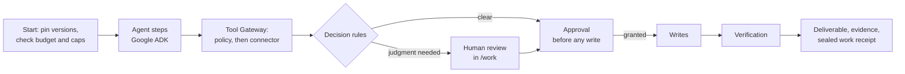

# New Machines

New Machines is a marketplace where a business picks AI agents and **workflow packs** (versioned, reviewable
definitions of a piece of business work, such as reconciling orders against payments) and runs them on its
own apps. Every tool call in a run is checked against policy, every write to a business system waits for a
person in the business to approve it, and judgment steps go to qualified human reviewers. Each run is metered
against a budget and a monthly cap, and ends with a deliverable, the evidence behind it and a hash-chained
**work receipt** of every step it took.

This repository is the working product: the buyer workspace, the developer Studio, the reviewer portal, the
operator console, and the API with its workflow runtime.

**Related repository:** the public marketing site, which describes this product and lists the marketplace
catalogue, is [newmachinesph/new-machines-biz-site](https://github.com/newmachinesph/new-machines-biz-site).

## What works today

The hosted deployment runs the real runtime (Temporal, Postgres) in the `live` workspace: each business
signs up into its own organization. A second mode, the `demo` workspace, serves synthetic data for showing
the product. `NM_WORKSPACE` picks one per deployment.

| Area | Status |
|------|--------|
| Workflow runtime: runs, retries, approvals, human tasks, budgets and caps | Live (Temporal + Postgres) |
| Agent steps (agents built on Google ADK) | Live, on Gemini models on Vertex AI; a fake provider for tests and keyless local runs |
| Policy checks on every tool call (Tool Gateway) and decision rules | Live |
| Work receipts (hash-chained, verified when a run page loads) | Live |
| App connections: Gmail, Google Calendar, Docs and Sheets, Shopify, Stripe | Live per workspace through each app's own sign-in, or simulated data per app; each connection picks |
| A workspace's own MCP servers as connectors | Live |
| Human review: claim, review, submit in the reviewer portal | Live; network reviewers see a redacted copy |
| Developer Studio: build, test in the sandbox, publish, list on the marketplace with operator review | Live |
| Billing, plan, publisher fees, reviewer pay and payouts | **Simulated**: metered from real run steps, but no money moves |
| Operator console guardrails | Pause-all-runs is enforced; the other switches are stored and labelled simulated |
| `demo` workspace data (orders, customers, usage, tenants) | **Simulated**: synthetic, tagged in the UI |

Simulated apps never read from or write to a real account, and the UI says so on every screen and
deliverable that used them.

## Repository map

| Path | What it is |
|------|------------|
| `apps/web` | Customer app (Next.js). `/app`: the buyer workspace (marketplace, runs, approvals, connections, reviewers, memory, usage, settings). `/studio`: the developer Studio (build agents and packs, publish listings). `/work`: the reviewer portal (claim and review tasks, earnings) |
| `apps/ops` | Operator console (Next.js) for New Machines staff: tenants, marketplace review, connectors, reviewer workforce, runs and receipts, definitions, memory, guardrails, billing, health, audit log. See [`apps/ops/README.md`](apps/ops/README.md) |
| `apps/api` | FastAPI service and the workflow runtime: `PackRunner`, one generic Temporal workflow that walks any pack; the worker (`app/worker`); the Tool Gateway and connector drivers (`app/runtime`); SQL migrations |
| `definitions/` | Everything a run executes, as YAML validated against `definitions/_schemas`: `packs/` (workflow, contract, sandbox data per pack), `agents/` (instructions and skills), `connectors/` (tools and sandbox responses), `decisions/` (decision rules), `memory/` (policy memory spaces), `models.yaml` (model profiles), `taxonomy.yaml` |
| `scripts/` | `smoke_recon.py` drives a full run end to end and verifies its receipt; `demo_data/` builds the Exception Desk's anonymised demo dataset ([README](scripts/demo_data/README.md)) |
| `compose.yaml` | Local Postgres (pgvector) and a Temporal dev server |

The API contract is `apps/api/openapi.json`; both Next.js apps generate their typed clients from it.

## How a run works



1. **Start.** The buyer starts a pack whose apps are all connected. The run pins a snapshot of every
   definition version it uses, checks the per-run budget and the workspace's monthly cap, and starts
   `PackRunner` on Temporal.
2. **Read and reason.** Agent steps (Google ADK) call tools only through the Tool Gateway, which applies the
   pack's contract and policy (allowed capabilities, input schemas) before routing the call to a live
   account, sandbox data or an MCP server. Memory steps recall the business's policies.
3. **Decide.** Ordered CEL decision rules route each item. A decision model can answer typed questions
   first; when it is unavailable, the pack falls back (for example, to a reviewer).
4. **Human review.** Judgment steps become tasks in the reviewer portal, for the business's own reviewers
   or the New Machines reviewer network. Network reviewers see a redacted copy.
5. **Approve.** Every write (a Gmail draft, a sheet row, a note in a ledger) waits for an approval from the
   business. If the approval is denied or times out, nothing is written.
6. **Verify and seal.** The output is checked against the contract's schema and rules, and the run ends
   with its deliverable, the evidence behind it and a receipt whose hash chain anyone can re-verify.

## Workflow packs that ship

All live in `definitions/packs/`. Prices are per-run estimates shown in the marketplace.

| Pack | Apps | Human step |
|------|------|------------|
| Order & Payment Reconciliation | Shopify, Stripe, Google Sheets | Reviewer for every mismatch; approval before the report is written |
| Order-to-Cash Exception Desk | Business app (store, ledger, warehouse, sales app), Gmail | One approval before any reminder draft or note |
| Overdue Invoice Follow-up | Stripe, Gmail | Reviewer checks the reminder plan; approval before drafts |
| Refund Triage | Gmail, Shopify, Stripe | Reviewer confirms every refund decision; never issues a refund |
| Support Inbox Triage | Gmail, Google Sheets | Reviewer for every complaint and refund request |
| Weekly Expense Check | Google Sheets, Gmail | Reviewer for flagged expenses |
| Inbox Lead Tracker | Gmail, Google Sheets | Approval before rows are added |
| Meeting Follow-ups | Google Calendar, Gmail | Approval before drafts are saved |

**Order-to-Cash Exception Desk** was contributed by **Adrian Anton Ladia**. It follows each order from store
to warehouse to ledger, finds payments waiting for confirmation, orders shipped but unpaid past terms, orders
paid but not shipped and disputed invoices, applies the business's collection policy, drafts reminders for
the largest overdue balances, and asks once before saving drafts and notes. It runs on synthetic sandbox
fixtures by default, and can read an anonymised MongoDB demo database through a read-only MCP server
(see [Run the Exception Desk on the demo database](#run-the-exception-desk-on-the-demo-database)).

## Run locally

Prerequisites: Docker, Python 3.14 with [`uv`](https://docs.astral.sh/uv/), Node 22+ with `pnpm`.

```bash
# 1. Postgres and Temporal (from the repo root)
docker compose up -d
docker compose ps            # both should report healthy

# 2. API with the runtime and an embedded worker on :8400 (in apps/api).
#    NM_MODEL_ENV defaults to "test": a fake model provider, so no keys are needed.
NM_RUNTIME=temporal NM_EMBEDDED_WORKER=1 NM_DEFS_AUTO_APPLY=1 AUTH_MODE=dev \
  ALLOWED_ORIGINS=http://localhost:3100,http://localhost:3400 \
  uv run uvicorn app.main:app --port 8400

# 3. Customer app on :3100 (in apps/web, in another terminal)
pnpm install && pnpm dev --port 3100

# 4. Operator console on :3400 (in apps/ops; its dev script pins the port)
cp .env.example .env.local && pnpm install && pnpm dev
```

Each Next.js app reads public settings from `.env.local` in its folder. For local work with mock sign-in
(no Firebase), this is enough; the Firebase values only need to be non-empty:

```bash
NEXT_PUBLIC_API_URL=http://localhost:8400
NEXT_PUBLIC_AUTH_MOCK=1
NEXT_PUBLIC_FIREBASE_API_KEY=local
NEXT_PUBLIC_FIREBASE_AUTH_DOMAIN=local
NEXT_PUBLIC_FIREBASE_PROJECT_ID=local
NEXT_PUBLIC_FIREBASE_APP_ID=local
```

`AUTH_MODE=dev` makes every API request an owner, in the `demo` workspace by default. Add
`NM_WORKSPACE=live` to run the live workspace locally (it needs `NM_RUNTIME=temporal`). Every API setting
and its default is in `apps/api/app/settings.py`, and `.env.example` lists them all: copy it to a gitignored
`.env` at the repo root for the decision model, Temporal Cloud or real app connections, and never commit it.
Real models are Gemini on Vertex AI (`definitions/models.yaml`): set `GOOGLE_CLOUD_PROJECT` and sign in with
`gcloud auth application-default login`; no model API key is needed.

On Windows, use `127.0.0.1` rather than `localhost` for Postgres and Temporal: the containers bind IPv4 only.

| Port | Service |
|------|---------|
| 8400 | API (local dev; also the API the ops e2e suite starts) |
| 3100 | Customer app (local dev and web e2e) |
| 3400 | Operator console (`pnpm dev`) |
| 8100 / 3410 | API under web e2e / console under ops e2e |
| 5442 | Postgres (user, password and database `nm`; tests use `nm_test`) |
| 7243 / 8243 | Temporal gRPC / Temporal UI |

`docker compose down -v` resets all local state.

### Run the real workflow locally

One command drives a whole run (start, human review, write approval, completion) against the local stack and
verifies the receipt. It exits non-zero if any step fails or the receipt does not end with its seal:

```bash
uv run --project apps/api python scripts/smoke_recon.py --model-env test   # fake model provider, no keys
uv run --project apps/api python scripts/smoke_recon.py --model-env dev    # Gemini on Vertex AI; GOOGLE_CLOUD_PROJECT in .env
uv run --project apps/api python scripts/smoke_recon.py --pack refund-triage --model-env test
```

`--pack` takes `order-payment-reconciliation` (default), `overdue-invoice-follow-up`, `refund-triage` or
`order-to-cash-exception-desk`. `--live` swaps sandbox connectors for live ones once real app accounts are
connected.

To run the worker as its own process instead of embedding it, start `uv run python -m app.worker` in
`apps/api` with the same `NM_RUNTIME` and model settings, and drop `NM_EMBEDDED_WORKER` from the API.

Definitions are validated and applied at API startup (`NM_DEFS_AUTO_APPLY=1`); an invalid file applies
nothing and is logged. To work on them directly, from `apps/api`:

```bash
uv run python -m app.defs validate    # check every file against the schemas
uv run python -m app.defs apply       # apply; skips definitions last published from the operator console
uv run python -m app.defs apply --force
```

### Run the Exception Desk on the demo database

The pack's `custom-business-app` connector can read MongoDB through the official MongoDB MCP server, run
read-only over loopback. Build and load the anonymised `nm_demo` database first
([scripts/demo_data/README.md](scripts/demo_data/README.md)), then:

```bash
MDB_MCP_CONNECTION_STRING=mongodb://127.0.0.1:27017/nm_demo \
  npx -y mongodb-mcp-server@3.1.0 --transport http --httpHost 127.0.0.1 --httpPort 8085 --readOnly \
  --maxDocumentsPerQuery 2000
```

Start the API (and the worker, if separate) with `NM_CONNECTOR_MODE=auto NM_MCP_URL=http://127.0.0.1:8085/mcp`.
In `auto` mode the connector reads the database when the server answers and its sandbox files otherwise;
the two note writes stay sandboxed in every mode and are recorded only in the receipt.

## Tests and checks

| App | Commands |
|-----|----------|
| API (`apps/api`) | `uv run pytest -q`, `uv run ruff check .`, `uv run ruff format --check .` |
| Web, ops (`apps/web`, `apps/ops`) | `pnpm test` (Vitest), `pnpm lint`, `pnpm typecheck`, `pnpm format:check`, `pnpm build` |
| End to end | `pnpm e2e` in `apps/web` or `apps/ops` (Playwright; builds a mock-sign-in bundle and starts its own API) |

- The API suite is large (about 2,000 tests, half an hour). Tests that use the database need
  `docker compose up -d`; set `NM_TEST_DATABASE_URL` to give parallel runs their own database.
- `pnpm e2e` uses the ports in the table above, so stop dev servers on them first. The web suite bakes
  `NEXT_PUBLIC_API_URL` into its build, so point it at its API (`http://localhost:8100`), and run it with
  `AUTH_MODE=dev` exported for the API it starts; `E2E_PORT` and `E2E_API_PORT` move its ports.
- After changing an API route or model, run `uv run python scripts/export_openapi.py` in `apps/api`, then
  `pnpm api:gen` in `apps/web` and `apps/ops`.
- `apps/api/tests/test_replay.py` replays a recorded `PackRunner` history against the current workflow code,
  so a change that would break in-flight runs fails the suite.

## Deployment

Everything runs on Google Cloud in project `nm-demo-iu7uo4`.

| Piece | Where | How |
|-------|-------|-----|
| API + embedded worker | Cloud Run service `nm-api` (asia-south1), Cloud SQL Postgres, Temporal Cloud | Cloud Build image, then `gcloud run deploy` |
| Customer app | Firebase App Hosting (asia-southeast1) | `firebase deploy --only apphosting` from `apps/web` |
| Operator console | Firebase App Hosting backend `nm-ops` (asia-southeast1) | the same command from `apps/ops` |

```bash
# API image: the Dockerfile builds from the repo root so the image carries definitions/
gcloud builds submit --project nm-demo-iu7uo4 --region asia-south1 --config apps/api/cloudbuild.yaml \
  --substitutions _IMAGE=asia-south1-docker.pkg.dev/nm-demo-iu7uo4/nm/nm-api:<tag> .
gcloud run deploy nm-api --project nm-demo-iu7uo4 --region asia-south1 \
  --image asia-south1-docker.pkg.dev/nm-demo-iu7uo4/nm/nm-api:<tag>

# Web apps (run in apps/web, then in apps/ops)
npx -y firebase-tools@15.33.0 deploy --only apphosting --project nm-demo-iu7uo4
```

- The API runs the Temporal worker in-process (`NM_EMBEDDED_WORKER=1`), so one service needs
  `--no-cpu-throttling`, `--min-instances 1` (Temporal polling is outbound and does not keep an instance
  alive) and `--max-instances 1` (one worker pool within the database connection budget). Delete the
  previous revision after a release so two workers never poll at once.
- Secrets live in Secret Manager and are wired as Cloud Run secrets; the app never logs connection strings
  or keys. `GET /v1/ops/runtime/status` (operators only) reports runtime, database, Temporal and worker health.
- Public client settings for the web apps are in each app's `apphosting.yaml`. Never leave a `.env.local`
  in the folder you deploy from: App Hosting uploads the folder.

## Known limits

- A live app write that succeeds but times out before it is recorded can repeat when the step retries.
- Connector data in workflow history is not yet encrypted; an encrypting payload codec is required before a
  paying business connects a real account.
- A run has no overall deadline; each human task or approval times out (24 hours by default).

## Contributing

1. Branch from `master` (`feat/...`, `fix/...`).
2. Keep the checks above green for every app you touch, and regenerate the API clients if the contract changed.
3. Open a pull request against `master` with a short description and how you tested it. Commit messages
   follow `type: description` (`feat`, `fix`, `docs`, `refactor`, `test`, `chore`).

New packs, agents and connectors are definition files: add them under `definitions/`, run
`uv run python -m app.defs validate` from `apps/api`, and add a sandbox fixture so the pack runs without real
accounts.
